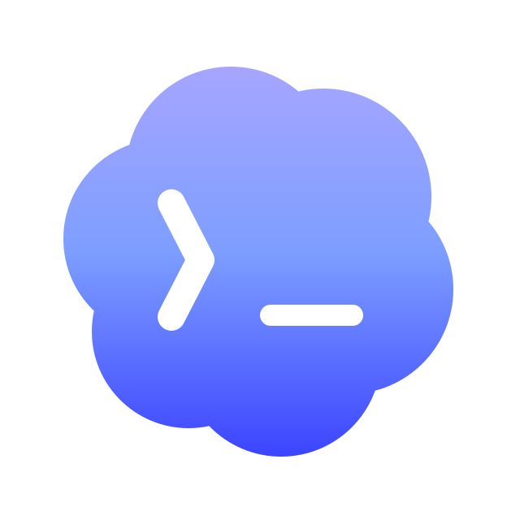

# skill-manager

[English](README.en.md)

<p align="center">
  
</p>

<p align="center">
  <strong>面向 AI 扩展的本地优先控制中心。</strong><br />
  在不同智能体工具之间统一管理、检查、扫描和发现 Skill、MCP 服务器、斜杠命令与 CLI 工具。
</p>

<p align="center">
  <a href="LICENSE"></a>
  <a href="#安装"></a>
  <a href="#安装"></a>
  <a href="#本地优先安全模型"></a>
</p>

## 为什么需要它

AI 扩展通常散落在各个智能体工具自己的文件夹、MCP 配置文件、斜杠命令目录和扩展市场中。Skill Manager 提供一个本地控制界面，把这些内容集中到一起管理。

| 产品概念 | 含义 |
|---|---|
| **使用中** | Skill Manager 已纳管此项目，并可在不同智能体工具中启用或停用。 |
| **待确认** | Skill Manager 发现了本地状态、配置差异或清单问题，需要你处理。 |
| **扫描** | 在信任某个 Skill 之前，使用 LLM 驱动的安全检查进行确认。 |
| **发现** | 浏览商城，并预览外部工具。 |

## 你可以做什么

- 查看哪些扩展正在使用、哪些需要确认，以及它们在哪些智能体工具中启用。
- 将本地 Skill 纳入统一清单，再按智能体工具启用或停用。
- 使用已保存的 LLM 服务商配置扫描 Skill，并在使用前查看扫描结果。
- 安装或纳管 MCP 服务器配置，解决配置差异，并写入受支持的智能体工具。
- 统一管理可复用的斜杠命令，并同步到受支持的智能体工具。
- 从商城来源发现 Skill、MCP 服务器，以及仅预览的 CLI 工具。

## 产品导览

### 总览

先从总览了解所有扩展，查看正在使用、等待处理和可以发现的内容，以及它们在各个智能体工具中的启用情况。

### Skill

把 Skill 作为共享的本地包管理，无需在每个智能体工具中分别维护副本。

典型流程

1. 检查智能体工具中发现的 Skill，或从扩展市场安装 Skill。
2. 将它纳入 Skill Manager 的统一清单。
3. 只在需要的智能体工具中启用。
4. 从一个地方更新、移除或删除。

### Skill 扫描

正式使用某个 Skill 之前，可以先用 LLM 驱动的安全检查扫描它。

典型流程

1. 添加并验证一个 LLM 扫描配置。
2. 在“使用中”页面切换到扫描视图。
3. 对单个 Skill、已选 Skill 或当前可见列表运行扫描。
4. 查看严重程度、发现项、代码片段和修复建议。

扫描配置单独管理。你可以保存多个服务商配置，指定当前使用的配置，列表中的 API Key 会经过遮盖处理。

### MCP 服务器

Skill Manager 会把 MCP 服务器保存为统一格式，再转换成各个智能体工具需要的配置。

典型流程

1. 检查智能体工具中发现的 MCP 服务器，或从扩展市场安装。
2. 将它纳入 Skill Manager 的统一清单。
3. 在需要的智能体工具中启用。
4. 集中处理配置差异、停用绑定或卸载。

### 斜杠命令

斜杠命令保存在共享提示词库中，无需针对每个智能体工具的格式重复维护。

典型流程

1. 创建包含名称、描述和提示词的斜杠命令。
2. 用 `$ARGUMENTS` 表示运行时输入插入位置。
3. 同步到受支持的智能体工具。
4. 检查已有的命令文件，按需纳入共享库。

### 商城

扩展市场用于发现新工具。

- **Skill 商城**用于浏览和安装 Skill。
- **MCP 商城**用于浏览和安装 MCP 服务器。
- **CLI 商城**用于预览 CLIs.dev 收录的外部 CLI 工具。这里仅提供展示，Skill Manager 不负责安装或管理 CLI。

## 安装

### 本地安装

```bash
cd coding
./scripts/install-dev.sh
```

### Windows 支持范围

原生 Windows 支持面向使用本机磁盘的 Windows 10 22H2 和 Windows 11 x64，不依赖 WSL、管理员权限或 Windows 开发者模式。

首个 Windows 版本支持完整的 **Codex CLI + Skill** 流程，包括发现已经安装的 Codex CLI、安装或纳管 Skill，以及在 `%USERPROFILE%\.agents\skills` 下启用或停用。Skill Manager 不负责安装、升级或登录 Codex。其他智能体工具、MCP 服务器管理和斜杠命令管理暂不支持 Windows。

Windows ARM64、Windows Server、UNC 路径、映射网络盘和便携式磁盘暂不在支持范围内。

## 支持的智能体工具

<table align="center">
  <tr>
    <td align="center" valign="middle">
      <br />
      <strong>Codex CLI</strong><br />
      <a href="https://developers.openai.com/codex/cli">文档</a>
    </td>
    <td align="center" valign="middle">
      <br />
      <strong>Claude Code</strong><br />
      <a href="https://code.claude.com/docs/en/overview">文档</a>
    </td>
    <td align="center" valign="middle">
      <br />
      <strong>Cursor</strong><br />
      <a href="https://cursor.com/docs">文档</a>
    </td>
    <td align="center" valign="middle">
      <br />
      <strong>OpenCode</strong><br />
      <a href="https://opencode.ai/docs">文档</a>
    </td>
    <td align="center" valign="middle">
      <br />
      <strong>Hermes Agent</strong><br />
      <a href="https://hermes-agent.nousresearch.com/docs">文档</a>
    </td>
    <td align="center" valign="middle">
      <br />
      <strong>OpenClaw</strong><br />
      <a href="https://docs.openclaw.ai/start/getting-started">文档</a>
    </td>
  </tr>
</table>

| 智能体工具 | Skill | MCP 服务器 | 斜杠命令 |
|---|---|---|---|
| Codex CLI | 支持 | 支持 | 支持 |
| Claude Code | 支持 | 支持 | 支持 |
| Cursor | 支持 | 支持 | 支持 |
| OpenCode | 支持 | 支持 | 支持 |
| Hermes Agent | 支持 | 支持 | 暂不支持 |
| OpenClaw | 支持 | 暂不支持 | 暂不支持 |

上表是 macOS 和 Linux 的支持情况。首个原生 Windows 版本的支持情况如下。

| 智能体工具 | Skill | MCP 服务器 | 斜杠命令 |
|---|---|---|---|
| Codex CLI | 支持 | 暂不支持 | 暂不支持 |
| 其他智能体工具 | 暂不支持 | 暂不支持 | 暂不支持 |

## 本地优先安全模型

Skill Manager 是一款本地配置管理工具。它在你的机器上运行，并读取或写入本地智能体工具的扩展状态。

以下操作会修改本地状态。

- 纳管本地 Skill 文件夹
- 为某个智能体工具启用或停用 Skill
- 更新带来源信息的 Skill
- 移除或删除 Skill
- 创建、更新、验证、激活或删除 LLM 扫描配置
- 运行 Skill 扫描，这会将所选 Skill 的上下文发送给已配置的 LLM 服务商
- 将 MCP 服务器安装到选定的智能体工具配置中
- 纳管已有的 MCP 配置
- 启用、停用、解决差异或卸载 MCP 服务器
- 创建、更新、同步、导入或删除斜杠命令
- 修改智能体工具的支持设置

在 macOS 上，应用拥有的文件位于 `~/Library/Application Support/skill-manager`；在 Linux 上使用 XDG base directories；在 Windows 上使用 `%APPDATA%\skill-manager` 和 `%LOCALAPPDATA%\skill-manager`。

## 工作方式

### Skill

纳管之前，各个智能体工具指向自己的本地 Skill 文件夹。纳管之后，Skill Manager 会在共享本地存储中保留一个标准包，再通过本地链接提供给选定的智能体工具。macOS 和 Linux 使用符号链接，Windows 使用普通用户即可创建的目录联接。停用某个智能体工具只会移除对应绑定，不会删除 Skill 包本身。

Skill Manager 默认把已管理的 Skill 视为可迁移内容。Skill 一旦进入共享存储，就可以启用到任何受支持的智能体工具。`originHarness` 只用于记录来源。

Hermes Agent Skill 使用分类目录 `~/.hermes/skills/<category>/<skill>/SKILL.md`。共享 Skill 启用到 Hermes 时，默认会链接到 `skill-manager` 分类下。Skill Manager 只导入 Hermes 从外部 Hub 安装的 Skill，也就是 `.hub/lock.json` 中不属于 official、builtin 或 optional 的条目。Hermes 自学习和本地 Skill、由 `.bundled_manifest` 跟踪的内置 Skill，以及 Hub 来源信息中记录的官方可选 Skill，均不会进入 Skill Manager 清单或批量操作范围。Skill Manager 不会修改、链接或删除这些文件夹，`hermes update` 和 Hermes 自身的 Skill 同步仍可按原有方式运行。

### Skill 扫描

Skill 扫描会从 `SKILL.md`、清单元数据、脚本、配置文件和 Skill 指令引用的文件中构建受限的提示词上下文。`.env`、私钥、证书和凭据文件等可能包含敏感信息的文件不会进入提示词上下文，超过扫描器大小限制的文件也会被跳过。

扫描器优先使用当前启用的 LLM 配置。如果没有启用任何配置，也可以读取受支持的环境变量，例如 `ANTHROPIC_API_KEY`、`OPENAI_API_KEY`、`OPENROUTER_API_KEY`、`GEMINI_API_KEY`、`GOOGLE_API_KEY`、`AZURE_OPENAI_API_KEY`、`AWS_BEDROCK_MODEL` 或 `OLLAMA_HOST`。

扫描报告会展示 Skill 是否安全、最高风险等级、问题位置、相关片段和修复建议。前端会把已完成的报告缓存在浏览器 `localStorage` 中，切换页面后仍可查看最近的扫描结果。

### MCP 服务器

MCP 服务器以统一的 Skill Manager 记录保存，再转换成每个智能体工具需要的配置格式。

- Codex 使用 `mcp_servers` 下的 TOML。
- Claude Code 和 Cursor 使用 `mcpServers` JSON 条目。
- OpenCode 使用类型化的本地或远程 MCP 条目。
- Hermes Agent 使用 `~/.hermes/config.yaml`（或 `$HERMES_HOME/config.yaml`）中 `mcp_servers` 下的 YAML 配置。
- OpenClaw 暂不支持 MCP 写入。

当 Skill Manager 发现同一个 MCP 服务器存在不同配置时，会先要求你选定基准配置。

### 斜杠命令

斜杠命令以 TOML 记录保存在 Skill Manager 的应用数据中，再转换成各个受支持智能体工具所需的格式。

- OpenCode 会把 Markdown 命令文件写入 `~/.config/opencode/commands`，并通过 `/` 调用。
- Claude Code 会把 Markdown 命令文件写入 `~/.claude/commands`，并通过 `/` 调用。
- Cursor 会把纯文本命令文件写入 `~/.cursor/commands`，并通过 `/` 调用。
- Codex 会把提示词文件写入 `~/.codex/prompts`，并通过 `/prompts:` 调用。
- Hermes Agent 暂不支持写入斜杠命令，可复用的 Hermes 工作流通过 Skill 管理。
- OpenClaw 暂不支持写入斜杠命令。

Skill Manager 使用同步状态和内容哈希记录目标文件的归属。它不会自动覆盖未跟踪的命令文件。目标文件与上次同步的哈希不一致时，页面会提示托管文件已变更或缺失。你可以纳管未托管的命令、恢复托管内容、把已修改的命令设为新来源，也可以移除失效绑定并保留原文件。

### CLI

CLI marketplace 条目仅用于预览。

## 配置

在 macOS 上，应用拥有的文件位于 `~/Library/Application Support/skill-manager`；在 Linux 上使用 XDG base directories；在 Windows 上，漫游配置使用 `%APPDATA%`，应用数据和运行状态使用 `%LOCALAPPDATA%`。

常用 macOS 路径

- 共享 Skill 存储位于 `~/Library/Application Support/skill-manager/shared`
- MCP 清单位于 `~/Library/Application Support/skill-manager/mcp/manifest.json`
- 斜杠命令库位于 `~/Library/Application Support/skill-manager/slash-commands/commands`
- 斜杠命令同步状态位于 `~/Library/Application Support/skill-manager/slash-commands/sync-state.json`
- 扩展市场缓存位于 `~/Library/Application Support/skill-manager/marketplace`
- 应用数据库和 LLM 扫描配置位于 `~/Library/Application Support/skill-manager/skill-manager.db`
- 应用设置位于 `~/Library/Application Support/skill-manager/settings.json`

常用 Linux 路径

- 共享 Skill 存储位于 `${XDG_DATA_HOME:-~/.local/share}/skill-manager/shared`
- MCP 清单位于 `${XDG_DATA_HOME:-~/.local/share}/skill-manager/mcp/manifest.json`
- 斜杠命令库位于 `${XDG_DATA_HOME:-~/.local/share}/skill-manager/slash-commands/commands`
- 斜杠命令同步状态位于 `${XDG_DATA_HOME:-~/.local/share}/skill-manager/slash-commands/sync-state.json`
- 扩展市场缓存位于 `${XDG_DATA_HOME:-~/.local/share}/skill-manager/marketplace`
- 应用数据库和 LLM 扫描配置位于 `${XDG_DATA_HOME:-~/.local/share}/skill-manager/skill-manager.db`
- 应用设置位于 `${XDG_CONFIG_HOME:-~/.config}/skill-manager/settings.json`

常用 Windows 路径

- 共享 Skill 存储位于 `%LOCALAPPDATA%\skill-manager\shared`
- 扩展市场缓存、应用数据库和运行状态位于 `%LOCALAPPDATA%\skill-manager`
- 应用设置位于 `%APPDATA%\skill-manager\settings.json`
- Codex Skill 根目录位于 `%USERPROFILE%\.agents\skills`

大多数用户不需要修改这些位置。如果你在自定义环境中管理 Skill，可以用环境变量覆盖单个 Skill 根目录。

| 智能体工具 | 环境变量 | 默认 Skill Manager Skill 根目录 |
|---|---|---|
| Codex | `SKILL_MANAGER_CODEX_ROOT` | `~/.agents/skills` |
| Claude | `SKILL_MANAGER_CLAUDE_ROOT` | `~/.claude/skills` |
| Cursor | `SKILL_MANAGER_CURSOR_ROOT` | `~/.cursor/skills` |
| OpenCode | `SKILL_MANAGER_OPENCODE_ROOT` | `~/.config/opencode/skills` |
| Hermes Agent | `SKILL_MANAGER_HERMES_ROOT` | `${HERMES_HOME:-~/.hermes}/skills` |
| OpenClaw | `n/a` | `~/.openclaw/skills` |

MCP 配置文件由各个智能体工具管理。Skill Manager 只写入经过验证的配置路径，并跳过不支持写入的工具。查找 Hermes Agent 配置时，会依次检查 `SKILL_MANAGER_HERMES_HOME`、`HERMES_HOME` 和 `~/.hermes`。

## 从源码运行

### 要求

- Python 3.11+
- Node.js 18+
- npm

`skill-manager` 支持 Python 3.11+。CI 会验证 Python 3.11 到 3.14 的后端兼容性；为了确定性，打包和发布构建仍固定在 Python 3.11。

### 贡献者设置

```bash
scripts/install-dev.sh
```

Windows PowerShell

```powershell
py -3.11 -m venv .venv
.\.venv\Scripts\python.exe -m pip install -r requirements.txt ".[build]"
npm ci
```

### 本地运行

```bash
scripts/start-dev.sh
```

Windows PowerShell

```powershell
npm run build
.\.venv\Scripts\python.exe -m skill_manager start --state-dir .artifacts\runtime
```

停止本地托管实例

```bash
scripts/stop-dev.sh
```

Windows PowerShell

```powershell
.\.venv\Scripts\python.exe -m skill_manager stop --state-dir .artifacts\runtime
```

需要 Vite 热更新时，可以分别启动前端和后端。

```bash
npm run dev
npm run dev:backend
```

默认本地地址

- 前端 `http://127.0.0.1:5173`
- 后端 `http://127.0.0.1:8000`
- 健康检查 `http://127.0.0.1:8000/api/health`

验证改动

```bash
scripts/install-dev.sh
npm run typecheck
bash scripts/test_backend.sh
npm test
npm run build
```

## 故障排查

- 如果商城请求失败并显示 `Marketplace is temporarily unavailable`，请确认网络连接后重试。
- 在 Windows 上，如果 Codex 显示不可用，请在同一个 PowerShell 中运行 `codex --version`，修复 `PATH` 后重启 Skill Manager。Skill Manager 不负责安装或登录 Codex。
- Windows Skill 绑定使用目录联接。请把 Skill Manager 数据目录和 Codex Skill 根目录放在本机磁盘；目前不支持网络盘和便携式磁盘。
- 如果某个 MCP 目标显示为不可用，说明 Skill Manager 检测到本地客户端缺失，或该客户端不支持所需配置。

## 后续计划

### 扩展类型

- [ ] Hook 支持
- [x] 斜杠命令支持
- [ ] Plugin 支持

### 支持更多智能体工具

- [ ] GitHub Copilot
- [ ] Gemini CLI
- [ ] Cline
- [ ] Windsurf
- [ ] Qwen Code
- [ ] Kimi Code
- [ ] Qoder

## 社区

- 查看 [CONTRIBUTING.md](CONTRIBUTING.md) 了解贡献指南。
- 查看 [SECURITY.md](SECURITY.md) 以私下报告安全漏洞。
